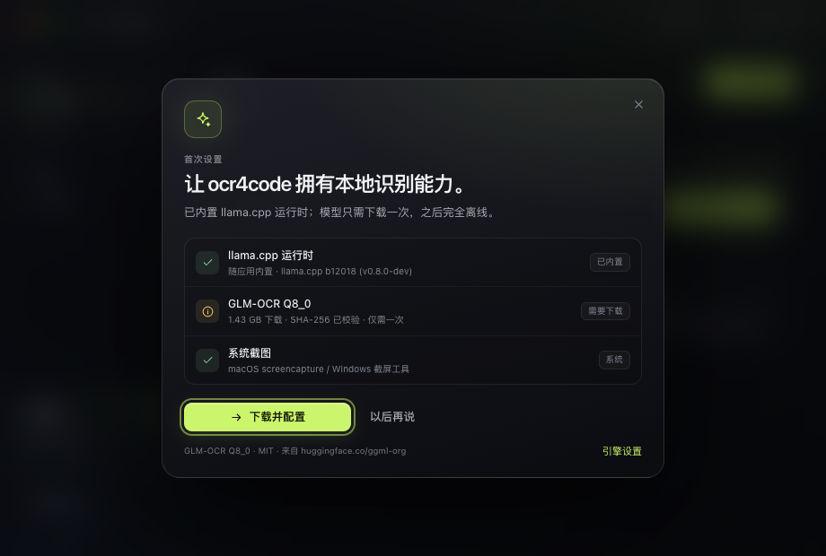
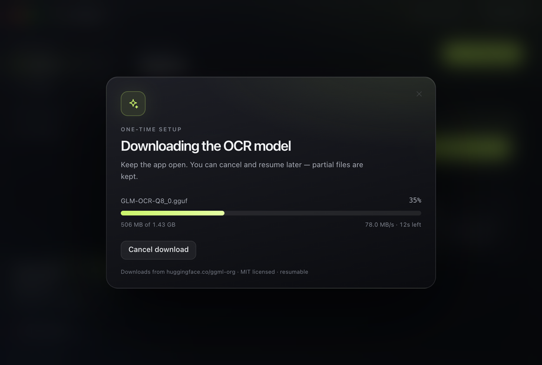
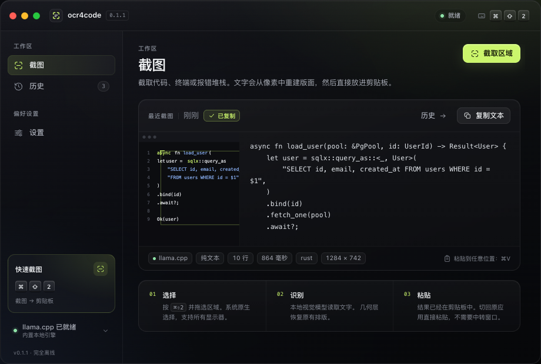
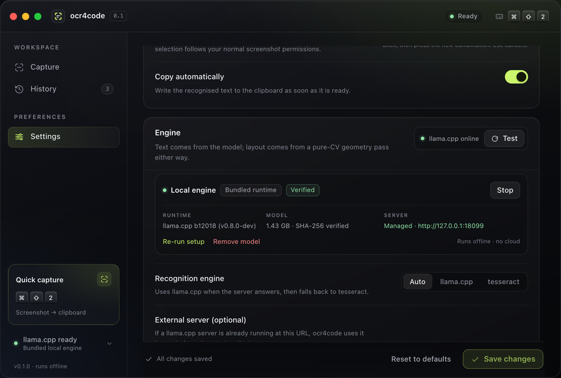

# ocr4code desktop

`ocr4code` 的桌面外壳：**快捷键框选截图 → 本地内核识别 → 文本直接进剪贴板**。
Tauri 2 + React 19 + TypeScript，直接复用仓库根目录的 Rust crate，不复制管线逻辑。

**用户安装后不需要装 llama.cpp，也不需要手动下载文件。**
安装包自带推理运行时；首次启动只需点一次「Download & set up」，应用会自动下载模型、
校验 SHA-256、启动引擎。之后完全离线。

> Windows 预览版安装包：
> <https://github.com/hfwang0318/ocr4code/releases/tag/v0.1.1>
> 由 GitHub Actions 的 `windows-latest` 构建 NSIS 安装器。

| 首启向导 | 模型下载 |
|---|---|
|  |  |

| 识别结果 | 本地引擎设置 |
|---|---|
|  |  |

实际 macOS 窗口（无边框玻璃材质）：
[识图](docs/capture-window.png) · [首启向导（干净机器）](docs/setup-native.png) · [已有 tesseract 时的首启横幅](docs/setup-banner-native.png)

---

## 1. 依赖：哪些打包，哪些下载

| 依赖 | 体积 | 处理方式 | 说明 |
|---|---|---|---|
| 应用本体（Tauri / React） | ~15–80 MB | **打包** | 随安装包 |
| `llama-server` 运行时 + 动态库 | macOS ~29 MB / Windows ~49 MB | **打包** | 固定 `llama.cpp b12018`（MIT），见 [runtime/README.md](src-tauri/runtime/README.md) |
| 截图能力 | 0 | **系统自带** | macOS `screencapture` / Windows Snipping Tool |
| WebView2（Windows） | — | **安装器自动处理** | `embedBootstrapper`，无需用户手动装 |
| GLM-OCR Q8_0 权重 + mmproj | **1.43 GB** | **应用内一键下载** | 950,433,408 + 484,403,648 bytes，MIT；不支持塞进安装包 |
| tesseract（可选兜底） | ~50–100 MB | **不打包、不强制** | 只检测系统已安装；默认不需要，模型路径是主力 |

模型不随安装包分发的原因：1.43 GB 会让安装包膨胀、更新成本高；而且权重与运行时可以独立升级。
如果面向内网/离线分发，后续可以额外做一个「离线模型包」，把两个 `.gguf` 放进 U 盘或内部镜像即可。

### 首次启动的一键流程

```text
打开应用
  └─ 首启向导：llama.cpp 运行时 ✓（已内置）
                 GLM-OCR 模型 ✗（1.43 GB）
        │
        └─ 点击「Download & set up」
              ├─ 下载两个文件（断点续传）
              ├─ SHA-256 校验
              ├─ 启动内置 llama-server（自动选端口、健康检查）
              └─ 就绪 → 直接按快捷键截图
```

下载过程有百分比、速度、ETA、当前文件；可取消，取消后保留 `.part`，下次继续。
不需要手动解压、放路径、启动服务或配置环境变量。

### 模型在哪里

| 平台 | 路径 |
|---|---|
| macOS | `~/Library/Application Support/com.ocr4code.desktop/models/glm-ocr/` |
| Windows | `%APPDATA%\com.ocr4code.desktop\models\glm-ocr\` |

`verified.json` 记录校验通过的模型 revision；`llama-server.pid` 用于清理异常退出留下的服务进程。

---

## 2. 能做什么

| 能力 | 说明 |
|---|---|
| 一键模型安装 | 首启向导下载 1.43 GB 模型、校验、启动服务；断点续传，可取消/重试/移除 |
| 全局快捷键 | 默认 `⌘⇧2` / `Ctrl+Shift+2`，设置里可录制；录制期间临时注销，避免自己触发自己 |
| 原生截图 | macOS `screencapture -i`，Windows `ms-screenclip:`；多显示器、菜单栏交给系统 |
| 自动识别 | 复用 `ocr4code::pipeline`：引擎 → 切块/重试 → 几何层 → 修复 → 渲染 |
| 自动复制 | 成功后直接写剪贴板；窗口隐藏时不抢焦点，托盘提示「copied N lines」 |
| 引擎管理 | 内置运行时、模型状态、服务状态、启动/停止、移除/重新下载，全部在设置里 |
| 设置面板 | 引擎、外部 server URL、prompt、token 预算、并发、tesseract 参数、版面开关、输出格式、历史条数 |
| 历史 | 最近 N 条结果留在本机 `localStorage`，可复制/删除/清空 |
| 深色玻璃 | 无边框窗口 + macOS `NSVisualEffectView` / Windows Acrylic + CSS 半透明层 |
| 托盘常驻 | 关闭窗口只隐藏；托盘可截图、打开窗口、退出 |

刻意没做：开机自启、自动更新、多图批量、自定义框选 overlay、云同步、账号。

---

## 3. 架构

```text
快捷键 / 托盘 / 按钮
        │
        ▼
capture.rs ──► 系统原生选区 ──► 临时 PNG
        │
        ▼
engine.rs ──► 运行时/模型检查 ──► 启动/复用 llama-server ──► 健康检查
        │
        ▼
pipeline::Config ──► pipeline::recognize（根 crate，CLI 同款）
        │
        ▼
render(text/markdown/json) ──► 剪贴板
        │
        └──► Tauri events ──► React（阶段、结果、下载进度）
```

| 层 | 文件 | 职责 |
|---|---|---|
| Web UI | `src/App.tsx`、`src/views/`、`src/components/` | 窗口 chrome、Capture / History / Settings、首启向导、快捷键录制、toast |
| 桥接 | `src/lib/bridge.ts` | Tauri `invoke`/`listen` 的类型化封装；浏览器预览自动切 mock |
| 引擎管理 | `src-tauri/src/engine.rs` | 模型 manifest、断点续传、SHA-256、llama-server 生命周期、端口/健康检查、下载事件 |
| 截图 | `src-tauri/src/capture.rs` | 原生选区、取消、OCR 流程、剪贴板、托盘提示、setup-required 错误 |
| 设置 | `src-tauri/src/settings.rs` | `settings.json` 读写、校验、`Settings → pipeline::Config` |
| Tauri | `src-tauri/src/lib.rs` | 命令、事件、托盘、窗口材质、autostart、SIGTERM/SIGINT 清理 |
| 内核 | `../src/pipeline.rs` | 与 CLI 共用的可复用管线 |

### 事件

| 事件 | 载荷 | 用途 |
|---|---|---|
| `ocr:phase` | `selecting` / `starting` / `recognizing` / `idle` | 忙碌态、引导文案 |
| `ocr:result` | `OcrResult` | 结果卡片、历史、toast |
| `ocr:error` | `{ message, hint, code? }` | 错误卡片；`setup-required` 自动打开向导 |
| `engine:download` | `DownloadProgress` | 百分比、速度、ETA、阶段、错误 |
| `engine:state` | `ServerInfo` | 服务 stopped/starting/online/failed |

### 引擎行为

- `auto`：优先外部 `llama_url` → 内置 server → tesseract 兜底。
- 显式 `llamacpp`：只用 llama.cpp；模型没装会提示 setup。
- 显式 `tesseract`：完全绕过模型下载。
- 启动时若模型已安装，后台自动拉起内置 server；加载约 7–10 秒。
- 外部已有 `llama-server` 时直接复用，不下载模型也能用（状态里显示 external）。
- 退出/收到 SIGTERM/SIGINT 时停止子进程；异常退出留下的进程由下次启动的 pid 文件清理。

---

## 4. 内核参数 → 设置面板

根 crate 的 `pipeline::Config` 是唯一事实来源；桌面层只负责持久化和展示。

| UI | 内核参数 | 默认 | 备注 |
|---|---|---|---|
| Recognition engine | `engine` | `auto` | 见上面的引擎行为 |
| External llama.cpp URL | `llama_url` | `http://127.0.0.1:8099` | 可选；内置 server 用独立端口 |
| Prompt | `prompt` | 基线默认 prompt | 对版面影响大于其它参数 |
| Max output tokens | `max_tokens` | `3072` | 同时决定切块行数上限 |
| Parallel engine calls | `jobs` | `3` | 只影响切块并发 |
| Tesseract language | `tess_lang` | `eng` | 如 `eng+chi_sim` |
| Page segmentation | `psm` | `6` | 3/4/6/7/11/13 |
| Tile tall screenshots | `tile` | 开 | 超预算按行带切块 + 一次重试 |
| Rebuild indentation | `!no_geometry` | 开 | 纯 CV 几何层 |
| Drop line-number gutters | `!keep_gutter` | 开 | 开关取反 |
| Join soft-wrapped lines | `join_wrap` | 关 | 启发式，误合并会毁行结构 |
| Format | `format` | `text` | text / markdown / json |
| Fence language | `language` | 空=猜 | 仅 markdown |
| Auto-copy | —（应用层） | 开 | 成功后写剪贴板 |
| History limit | —（应用层） | 20 | 只影响 `localStorage` |

`mock_text` / `mock_text_file` 保留给 CLI 测试，不暴露在 UI。

设置保存时会重新注册全局快捷键：失败会恢复旧值并把错误显示在 Settings 底栏；
启动时注册失败则标题栏显示「Shortcut unavailable」。

---

## 5. 开发 / 构建

要求：Rust stable、Node 20+、pnpm；macOS 需要 Xcode CLT，Windows 需要 C++ build tools。

```bash
cd app
pnpm install
pnpm tauri dev          # Vite + Tauri 窗口
pnpm build              # TS 类型检查 + 前端构建
pnpm tauri build        # .app / .dmg / .msi / .exe
```

运行时二进制不提交到仓库（约 78 MB），构建前先获取：

```bash
cd app
python3 scripts/fetch-runtime.py --platform macos-arm64     # macOS
python  scripts/fetch-runtime.py --platform windows-x64     # Windows
```

Windows 发布流程见 [`.github/workflows/release.yml`](../.github/workflows/release.yml)：
tag push 后在 `windows-latest` 上拉取 runtime、跑后端测试、构建 NSIS 并上传到 Release。

### 运行时资源

`src-tauri/runtime/macos-arm64/` 与 `runtime/windows-x64/` 是随包分发的 llama.cpp 运行时。
平台配置 `tauri.macos.conf.json` / `tauri.windows.conf.json` 把它们映射到安装包的
`Resources/runtime/llama/`。macOS 必须保留 `@loader_path` 依赖的 dylib 平铺目录。

重新获取（固定 b12018）：

```bash
cd app
python3 scripts/fetch-runtime.py --platform macos-arm64
python3 scripts/fetch-runtime.py --platform windows-x64
```

### 浏览器预览

```bash
cd app && pnpm dev
# http://127.0.0.1:1420/?demo=result
#                       ?demo=setup | empty | history | settings | error
```

`src/lib/bridge.ts` 在没有 `__TAURI_INTERNALS__` 时切到 mock：模拟下载进度、结果、引擎状态；
设置写 `localStorage`。界面截图就是这样生成的。

### 后端自测

```bash
# 用真实 Hugging Face 下载模型到应用数据目录（约 1.43 GB），并打印进度
cd app/src-tauri
cargo run --example engine_probe -- download
# 启动内置 server，健康检查后退出
cargo run --example engine_probe -- start
```

### 代理

模型下载会读取 `HTTPS_PROXY` / `https_proxy` / `ALL_PROXY` / `HTTP_PROXY`。
本地健康检查（`127.0.0.1`）不走代理。Finder 启动的 App 可能不继承 shell 环境变量，
这种情况下需要在系统级配置代理，或用命令行启动应用。

如果使用内部镜像/离线服务，把 `OCR4CODE_MODEL_BASE` 设为包含 resolve 路径的基址，例如
`https://mirror.example/ggml-org/GLM-OCR-GGUF/resolve/65a42de...`，文件名与 SHA-256 仍按内置
manifest 校验。也可以直接把两个 `.gguf` 放进模型目录做离线预置。

---

## 6. 平台细节

| | macOS | Windows |
|---|---|---|
| 选区 | `/usr/sbin/screencapture -i -x -o -t png` | `ms-screenclip:` + 轮询剪贴板图像 |
| 取消 | Esc；再按一次全局快捷键 kill 子进程 | Esc；再按一次全局快捷键停止轮询 |
| 权限 | 首次需要 **Screen Recording**，在系统设置 → 隐私与安全勾选后重启 | Snipping Tool 负责 |
| 运行时 | bundled macos-arm64（Metal） | bundled win-cpu-x64（CPU，`-ngl 0`） |
| 材质 | `NSVisualEffectMaterial::HudWindow` | `apply_acrylic` |
| 无边框窗口 | 自绘红黄绿 + `data-tauri-drag-region` | 自绘最小化/最大化/关闭 |
| WebView2 | 系统自带 | 安装器 `embedBootstrapper` 自动处理 |

Windows 分支按 `cfg` 条件编译编写，但没有 Windows 真机；`ms-screenclip:` 在不同
Win10/11 版本上的行为、CPU 推理速度还需要一次真机验证。Windows 运行时是 CPU 版；
要 GPU 加速可以后续增加 Vulkan/CUDA 运行时包，或让高级用户接外部 llama-server。
当前 macOS 产物是 arm64；Intel Mac 需要单独构建 x64 并补充 `runtime/macos-x64`。

---

## 7. 数据与文件

| 内容 | 位置 |
|---|---|
| 设置 | macOS `~/Library/Application Support/com.ocr4code.desktop/settings.json`；Windows `%APPDATA%\com.ocr4code.desktop\settings.json` |
| 模型 | 同级 `models/glm-ocr/`；`*.part` 为可续传临时文件 |
| 服务日志 | macOS `~/Library/Logs/com.ocr4code.desktop/llama-server.log`；Windows 应用日志目录 |
| 历史 | WebView `localStorage`（`ocr4code.history.v1`） |
| 临时截图 | cache 目录，识别完成/取消后删除 |
| 设置损坏 | 改名为 `settings.json.bak`，回退默认值 |

历史只存文本和元数据，不存原图；缩略图只存在于当前结果卡片。

---

## 8. 验证状态（2026-10-31）

```bash
cargo test                       # 根 crate: 34 unit + 5 integration
cd app/src-tauri && cargo test   # 桌面层: 7 tests（含 engine manifest/校验/断点续传）
cd app && pnpm build             # tsc + vite，通过
cd app && pnpm tauri build --debug --bundles app
```

已在 macOS 真机验证：

- 安装包内 `Resources/runtime/llama/llama-server` 可执行，资源路径解析正确；
- 用内置 manager 从 Hugging Face 实际下载 1.43 GB 模型，SHA-256 校验通过；
- 内置 `llama-server` 加载真实 GLM-OCR 模型，`/health` 返回 200，启动约 7–10 秒；
- 应用 autostart 后侧栏显示「llama.cpp ready · Bundled local engine」；
- 通过同一 server 跑通 CLI OCR；
- SIGTERM 会停止子进程；异常退出留下的 pid 文件会在下次启动时清理。

未验证：Windows 真机、macOS 选区 + 全局快捷键的自动化点击（自动化环境没有辅助功能权限）、
代码签名/公证后的嵌套 dylib 签名。发行时需要把 `runtime/llama/` 里的 `llama-server` 和所有
dylib/DLL 一并签名，否则公证/信任链可能不完整。

---

## 9. 目录

```text
app/
├── src/                         React + TS
│   ├── components/              SetupDialog, Icon, Logo, Controls, WindowChrome, Sidebar, Toast
│   ├── views/                   CaptureView, HistoryView, SettingsView
│   ├── lib/                     bridge, types, defaults, platform, history, status, format
│   └── styles/                  tokens.css, shell.css, views.css
├── src-tauri/
│   ├── src/lib.rs               Tauri builder / commands / tray / window material / signals
│   ├── src/engine.rs            运行时、模型下载/校验、llama-server 生命周期
│   ├── src/capture.rs            selection → pipeline → clipboard
│   ├── src/settings.rs           Settings ↔ pipeline::Config
│   ├── runtime/                  bundled llama.cpp（macos-arm64 / windows-x64）
│   ├── examples/engine_probe.rs 开发用 download/start/status 探针
│   ├── capabilities/             窗口权限
│   ├── tauri.conf.json
│   ├── tauri.macos.conf.json     resources: runtime
│   └── tauri.windows.conf.json   resources + WebView2 bootstrapper
├── scripts/fetch-runtime.py     重新获取固定版本运行时
├── THIRD_PARTY.md               运行时与模型许可
├── docs/                        界面截图
└── app-icon.png                 源图标
```
